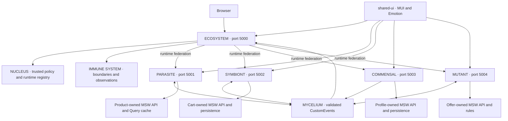

# Architecture

MICROVERSE is a five-application React/TypeScript pnpm workspace using genuine runtime Module Federation. ECOSYSTEM owns composition and infrastructure; each organism owns its business model, API handlers, TanStack Query cache, persistence and standalone entry. Applications never import another application's source. There is no shared business store.

## Responsibilities and routes

| Owner     | Responsibility                                                                                                  | Host route        |
| --------- | --------------------------------------------------------------------------------------------------------------- | ----------------- |
| ECOSYSTEM | Shell, navigation/router, composition, registry/policy, remote boundaries, observed status/activity, Cart count | `/`, `/ecosystem` |
| PARASITE  | Product listing/detail, search, filters, sorting, prices, stock and add requests                                | `/products/*`     |
| SYMBIONT  | Cart reconciliation, quantities, integer-paise totals, confirmed discounts, persistence and simulated checkout  | `/cart`           |
| COMMENSAL | Profile validation, editing, preferences, local persistence and privacy-preserving save facts                   | `/profile`        |
| MUTANT    | Coupon eligibility, validity, minimums, selection, percentage/free-shipping quotes and reconciliation           | `/offers`         |

The Host supplies one router/theme for embedded routes; standalone entries supply their own root, router where needed, theme and navigation. Host route titles and focus management support keyboard navigation. Dashboard cards show configured versions and current module/view observations, not invented server health or deployments. Its event feed retains only validated metadata observed while the shell is mounted; business payloads stay private. Recent runtime observations are separately timestamped and may predate the current page.

## Genuine shared infrastructure

- `packages/mycelium`: typed Zod-validated event contracts, CustomEvent transport, opaque durable product-intent inbox and diagnostics. No cart/offer/profile rules.
- `packages/shared-ui`: MUI dark theme/tokens and reusable presentation components. No router, API or business state.
- `packages/shared-types`: product, embedded-entry and release contracts.
- `packages/mock-utils`: MSW transport/bootstrap, latency/failure scenarios and HTTP helpers. No domain handlers or seeds.
- `packages/config`: strict/shared Vite/test and federation singleton configuration.

The Host asynchronously starts the small SYMBIONT and MUTANT lifecycle facades so incoming intents and Cart pricing reconcile even when their route UI is absent. Each facade returns cleanup and exposes no mutation/store API to the Host. Owner services use reference-counted lifetimes; route unmount does not create a second owner. The Host listens to facts to display the count and activity only.

## Runtime and persistence

NUCLEUS fetches one validated snapshot per document. An operator-controlled exact-origin policy precedes registration; compatible exposed release metadata precedes application/service loading. No Host rebuild is required to select an already trusted remote version. Per-remote loading/error boundaries isolate ordinary failures, with bounded waits and explicit recovery. See [federation](module-federation.md), [registry](nucleus.md), and [resilience](resilience.md).

MSW is deliberately included in built demonstrations. Owner APIs are intercepted in the browser rather than served by a real backend. Each origin/tab has private session persistence; embedded owners share the Host origin but use distinct namespaced keys. Product intents are persisted before dispatch, and Cart commits state plus applied IDs before acknowledgement. Cart state remains SYMBIONT-owned; MYCELIUM is not a centralized business store. MUTANT reconciles via Cart facts/request-response events, never remote source imports.

## Delivery, security and limits

Each application has an independent Netlify pipeline/target. A separate registry target enables validated promotion/rollback without publishing the Host. Live targets/credentials are unavailable; live deployment is unverified. Local independently built release switching and CI builds are separate verified scopes. See [deployment](deployment.md), [development](development.md), and [acceptance](acceptance.md).

Federation code executes with Host privileges. Boundaries and CSP do not sandbox malicious approved code. Origin policy, code/deployment review, HTTPS, secret isolation and CSP remain necessary. No real authentication, account backend, payment, notification delivery or translation service is implemented. Monetary data, inventory, coupons and checkout are explicitly mock/simulated. [Architecture decisions](decisions/) and [implementation history](IMPLEMENTATION_PROGRESS.md) record actual milestones and limitations.
