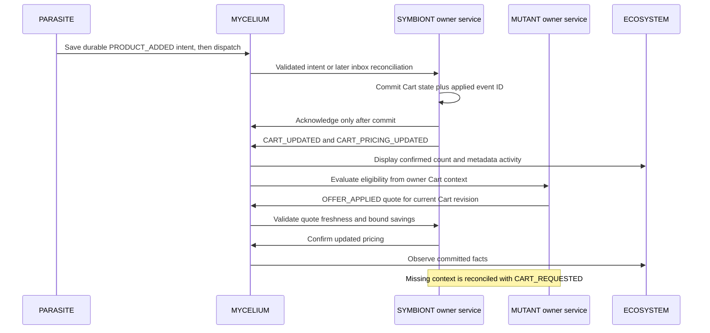

# MYCELIUM communication

MYCELIUM carries typed browser CustomEvents, not shared business state. No remote imports another remote or writes its state. Zod validates discriminated envelope/payload contracts on publishing and receiving. Subscribers clean up explicitly; a failed subscriber does not stop others.

## Envelope and API

Every envelope has UUID event ID, namespaced event name, source application, ISO timestamp, schemaVersion 1, UUID correlation ID and payload. `createMycelium(source)` binds the source once and exposes publish(event, payload), subscribe(event, callback) and unsubscribe(event, callback). Subscribe returns cleanup. The lower-level publish also accepts source/correlation options. Contracts restrict which owner can publish each event; this is validation, not protection against malicious trusted JavaScript.

| Event                             | Owner     | Payload purpose                                                       |
| --------------------------------- | --------- | --------------------------------------------------------------------- |
| `microverse:product:added`        | Parasite  | Product transport snapshot and quantity intent                        |
| `microverse:product:removed`      | Symbiont  | Removed product ID/quantity fact                                      |
| `microverse:cart:updated`         | Symbiont  | Committed item count and monetary summary/revision                    |
| `microverse:cart:cleared`         | Symbiont  | User/checkout reason and revision                                     |
| `microverse:cart:pricing-updated` | Symbiont  | Cart pricing context, revisions, delivery and confirmed quote context |
| `microverse:cart:requested`       | Mutant    | Request current owner context; empty payload                          |
| `microverse:offer:applied`        | Mutant    | Owner-evaluated quote, Cart revision and expiry                       |
| `microverse:offer:removed`        | Mutant    | Code, revision and removal reason                                     |
| `microverse:profile:updated`      | Commensal | Successful tab-profile save fact; no name/email/address               |
| `microverse:checkout:completed`   | Symbiont  | Committed order ID/count/total with simulated=true                    |

Profile and checkout facts are additive schema-1 events. Existing event payloads and compatibility remain unchanged. Profile facts cannot include profile fields; checkout facts cannot claim a real payment. All price calculations belong to owners and use integer paise, not transport helpers.

## Delivery and state ownership

CustomEvents are transient. PRODUCT_ADDED is persisted as an opaque envelope in a tab/origin-scoped sessionStorage inbox **before dispatch**. SYMBIONT drains on service startup and after relevant actions, deduplicates applied IDs, applies its own stock/quantity rules and atomically persists Cart state plus processed IDs. Only then does it acknowledge/remove the inbox entry. A failed commit leaves the intent for reconciliation. MYCELIUM does not apply cart actions or calculate prices.

The inbox holds at most 100 pending intents and visibly rejects overflow. SYMBIONT retains 1000 applied receipts. Corrupt inbox/persistence is preserved/reported rather than silently discarded. This is bounded demonstration durability, not account-backed exactly-once delivery. See owner tests for replay, storage failures and limit handling.

The Host starts Cart and Offers lifecycle facades independently of their route UI. MUTANT requests Cart pricing when it mounts/starts; SYMBIONT responds with its current owned context. Offers selection persists locally and reconciles against current Cart revision/eligibility. Stale or expired quotes cannot silently discount a changed cart. Other informational events, including profile/checkout facts, are not durable; their owners' persistence is the authority.

## Diagnostics and cleanup

Transport diagnostics retain up to 100 metadata records per module instance, never payloads. The Host activity observer subscribes to validated events while its shell is mounted, deduplicates IDs, retains at most 30 metadata records in memory and displays the latest ten. It does not infer pre-mount events or treat history as business state. The separate IMMUNE SYSTEM history has its own bounded runtime observations. Neither feed claims server health or deployment history.

Each subscriber returns cleanup. Reference-counted owner service lifetimes remove CustomEvent listeners and timers when their final user stops. Host observers and view subscriptions likewise clean up on unmount, including StrictMode setup/cleanup. Unit tests cover unsubscription, malformed events, subscriber errors, bounded observation and durable replay; Playwright verifies actual Product→Cart→Host, Cart→Offers→Cart, private profile facts and checkout behavior across federated modules.
