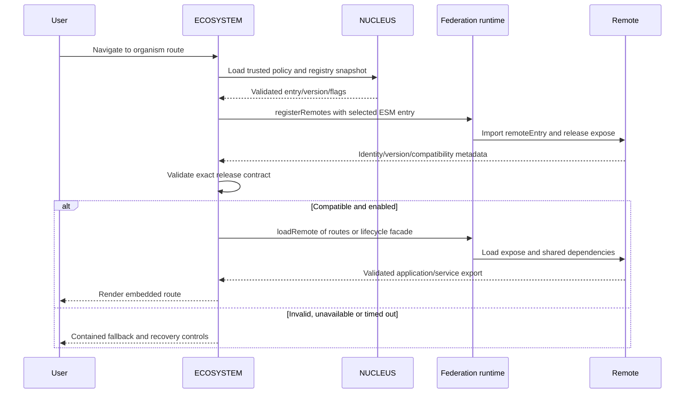

# Runtime Module Federation

MICROVERSE uses `@module-federation/vite` 1.23.11 and `@module-federation/runtime` 2.9.3. Official [Vite integration](https://module-federation.io/integrations/build-tool/vite) and [runtime APIs](https://module-federation.io/guide/runtime/runtime-api) were verified before implementation. There are no ordinary local component imports masquerading as federation.

## Build contracts and sharing

ECOSYSTEM's plugin initializes the runtime/shared providers with `remotes: {}` and loaded-first sharing. Runtime registry selection supplies URLs later. Each remote independently builds an ESM remoteEntry.js and hashed chunks, runs standalone, and exposes:

| Remote    | Exposes                                     |
| --------- | ------------------------------------------- |
| PARASITE  | `./release`, `./routes`                     |
| SYMBIONT  | `./release`, `./routes`, `./cart-service`   |
| COMMENSAL | `./release`, `./routes`                     |
| MUTANT    | `./release`, `./routes`, `./offers-service` |

Routes export a default embedded component, not createRoot. Lifecycle facades export startCartService/startOffersService returning cleanup. Release metadata declares exact identity/version plus Host API 1, MYCELIUM 1, React major 19 and MUI major 9 compatibility.

`packages/config/src/federation.ts` aligns compatible React/React DOM, JSX/client subpaths, Router, MUI and Emotion singleton contexts with pnpm suffix matching. The workspace catalog aligns versions: React 19.3.1, Router 8.5.1, MUI 9.5.0 and Emotion 11.14.x. Babel runtime fallback is explicit without overriding Emotion's nested dependency. Each standalone entry supplies its own ThemeProvider/root; an embedded entry consumes the Host's existing theme/router.

## Supported loading flow

`createRemoteLoader` calls `registerRemotes([{name, type:'module', entry}])` on the plugin's runtime, then `loadRemote('<id>/release')`, validates metadata, and calls `loadRemote('<id>/<expose>')`. It validates the required function export. Release checks deduplicate per document; all consumers use the same pinned NUCLEUS snapshot. React.lazy/Suspense provides route loading UI. No second runtime sharing instance or forced live container replacement is introduced.

NUCLEUS validates policy, exact trusted origins, enabled/feature flags, version syntax and production HTTPS/versioned paths before imports. The remote container executes before its release metadata can be checked: metadata establishes declared compatibility, not code authentication. See [runtime registry](nucleus.md).

## Failures and recovery

Release and expose waits each have a 12-second limit. Timeout stops waiting, not native ESM execution; attempt tokens prevent late completion from overwriting a failure. Per-remote boundaries contain rendering errors and failed lazy loads. Headless service startup is separately caught/observed. Retry view remounts a failed rendering subtree; Retry remote opens a fresh document to clear failed import caches and reselect the registry. Already loaded code can continue after its server stops. Module load success is not continuous health or API readiness. See [failure handling](resilience.md).

## Verification and deployment

Playwright serves actual independent production builds on all five ports, traverses real exposes, rejects mismatched release metadata, and isolates an unavailable remote. Its release scenario independently publishes Cart 1.0.1 locally, edits only the runtime registry, verifies its visible version and unchanged Host SHA-256, and rolls back to a retained 1.0.0 artifact. The fixture never replaces a remote module with a local React component.

Production pipelines publish immutable `/releases/<version>/` directories and retain older releases. Protected registry promotion verifies bytes, contracts and candidate/published browser loading against the existing Host. Those live gates remain unverified without real targets/credentials. [Deployment](deployment.md) distinguishes verified local/CI evidence from pending live acceptance. Shared MUI's Host chunk-size advisory remains a known optimization opportunity, not a hidden build failure.
